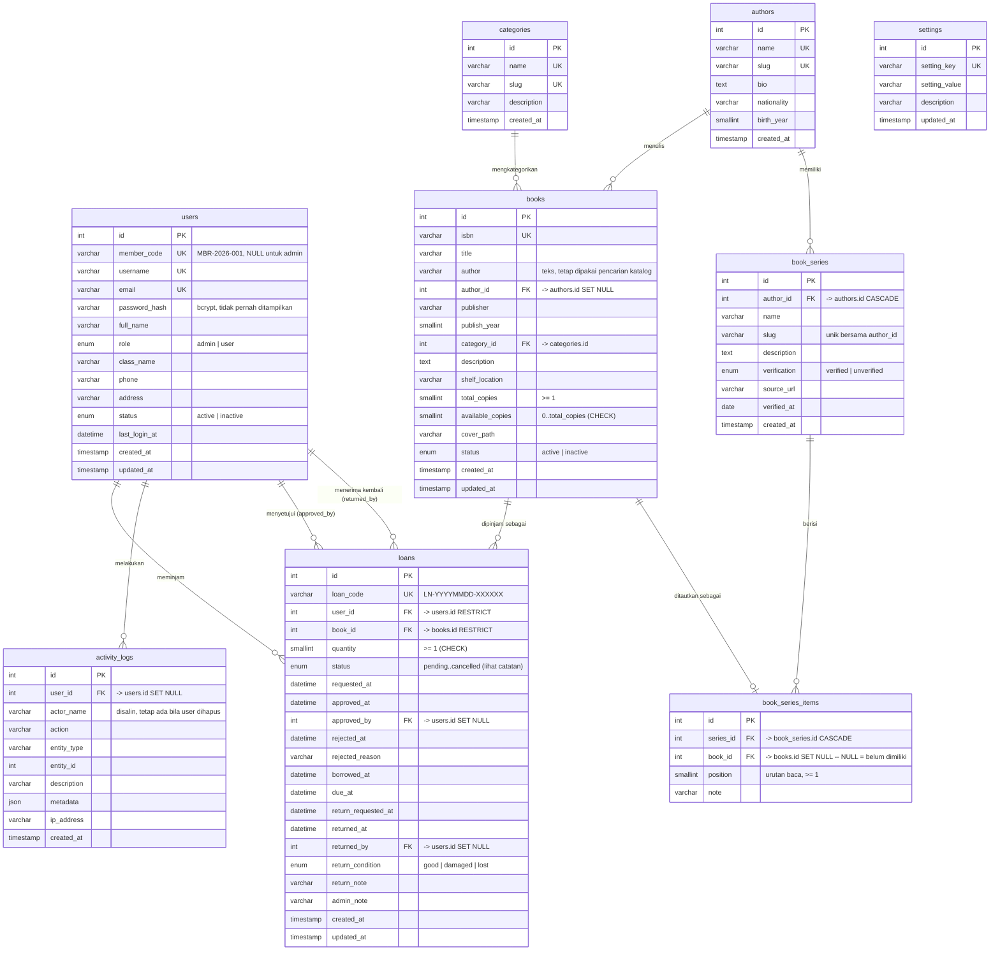

# ERD — LUMEN Digital School Library Management System

Diagram ini dapat dirender di GitHub, VS Code (plugin Mermaid), atau tools online
seperti [mermaid.live](https://mermaid.live).

## 1. Diagram Relasi Entitas



## 2. Penjelasan Relasi

| Relasi | Kardinalitas | Aturan Penghapusan | Alasan |
|---|---|---|---|
| `users` → `loans` | 1 : N | `RESTRICT` | Riwayat peminjaman tidak boleh hilang |
| `books` → `loans` | 1 : N | `RESTRICT` | Judul yang pernah dipinjam tidak boleh hilang |
| `categories` → `books` | 1 : N | `RESTRICT` | Buku wajib punya kategori yang valid |
| `users` → `loans` (approved_by) | 1 : N | `SET NULL` | Transaksi tetap valid walau petugas dihapus |
| `users` → `loans` (returned_by) | 1 : N | `SET NULL` | Idem |
| `users` → `activity_logs` | 1 : N | (tanpa FK) | Log bersifat append-only |
| `authors` → `books` | 1 : N | `SET NULL` | Buku tetap ada walau penulis dihapus |
| `authors` → `book_series` | 1 : N | `CASCADE` | Seri tidak bermakna tanpa penulisnya |
| `book_series` → `book_series_items` | 1 : N | `CASCADE` | Menghapus seri SHOULD menghapus urutan |
| `books` → `book_series_items` | 1 : 0..N | `SET NULL` | Buku yang dihapus jadi "belum ada di koleksi", bukan NULL mendadak |

### Aturan penghapusan dalam aplikasi
- Buku yang **pernah** dipinjam → di-*soft delete* (status `inactive`), tidak dihapus fisik.
- Anggota yang **pernah** punya transaksi → dinonaktifkan, tidak dihapus fisik.
- Kategori yang masih memiliki buku → penghapusan ditolak.

---

## 3. Catatan Penting

### 3.1 Status `overdue` tidak disimpan

`loans` **tidak** memiliki kolom status `overdue`. Status tersebut dihitung saat query:

```sql
CASE
  WHEN l.status IN ('borrowed','return_requested')
       AND l.due_at IS NOT NULL AND l.due_at < NOW()
  THEN 'overdue'
  ELSE l.status
END AS display_status
```

**Alasan:** menyimpan status yang bergantung waktu membutuhkan scheduled job yang
menyimpan ulang baris setiap saat. Pendekatan ini prone terhadap *drift* (data basi)
dan tidak diperlukan karena jatuh tempo sudah tersimpan di `due_at`.

### 3.2 Tidak ada tabel `returns` terpisah

Seluruh siklus hidup peminjaman — termasuk pengembalian — disimpan di satu tabel
`loans` (`returned_at`, `returned_by`, `return_condition`, `return_note`).
Tabel terpisah tidak akan menambah nilai dan berisiko menimbulkan data yang
tidak konsisten.

### 3.3 Integritas stok

`books.available_copies` adalah angka turunan (denormalized) yang **wajib** dijaga
konsisten dengan `loans`. Nilainya hanya boleh diubah di dalam transaksi database:

```sql
SELECT ... FROM books WHERE id = ? FOR UPDATE;   -- kunci baris buku
SELECT ... FROM loans  WHERE id = ? FOR UPDATE;   -- kunci baris transaksi
UPDATE books SET available_copies = available_copies - 1 WHERE id = ?;
```

Ditambah `CHECK (available_copies >= 0 AND available_copies <= total_copies)`
sebagai pengaman lapis database.

### 3.4 `book_series_items.book_id` boleh NULL

Kolom ini **sengaja opsional**. Ia mewakili judul yang sudah diverifikasi secara
bibliografis tetapi belum dimiliki perpustakaan.

Alternatifnya adalah membuat baris `books` kosong agar relasinya penuh, tetapi
itu berarti **mengarang inventaris** — Persis yang dilarang.

Akibatnya, satu seri dapat tampil dengan `totalItems` 17 dan `ownedItems` 0.
Antarmuka menentukannya sebagai "belum ada di koleksi" dan **tidak** memberi
tombol pinjam.

### 3.5 `books.author` (teks) dan `books.author_id` (relasi) berdampingan

Kolom `author` berupa teks dipertahankan karena pencarian katalog
"cari judul, penulis, ISBN" sudah memakainya dan harus tetap bekerja persis
sebelumnya. Sementara itu `author_id` menambah relasi yang bisa di-query
(untuk penulis, seri, dan pengelompokan).

Keduanya di-backfill: `author_id` diisi dengan mencocokkan `books.author` ke
`authors.name`. Ini bukan duplikasi yang bisa berbeda — `author` adalah data
yang sudah ada, `authors` adalah normalisasinya, dan `author_id` adalah
jembatan yang selalu konsisten karena di-backfill saat migrasi.

### 3.6 Dua foreign key pada `users`

`loans` memiliki **dua** foreign key ke `users`: `user_id` (pemilik) dan
`approved_by` / `returned_by` (petugas). `approved_by` dan `returned_by`
menggunakan `ON DELETE SET NULL` agar transaksi tidak hilang saat akun petugas
dinonaktifkan.

---

## 4. Tabel Pengaturan (`settings`)

| `setting_key` | Nilai awal | Arti |
|---|---|---|
| `max_loan_per_user` | `3` | Maksimal buku aktif bersamaan per siswa |
| `loan_duration_days` | `7` | Masa pinjam (hari) sejak buku diserahkan |
| `require_approval` | `1` | `1` = perlu persetujuan petugas, `0` = langsung aktif |
| `allow_self_return` | `1` | `1` = siswa boleh mengajukan pengembalian sendiri |
| `late_fee_per_day` | `1000` | Denda keterlambatan per hari (Rp) |

---

## 5. Kompilasi Ulang Skema

Untuk membuat ulang seluruh skema dari nol:

```sql
DROP DATABASE IF EXISTS lumen_db;
-- lalu import ulang database.sql
```
