# ERD — LUMEN Digital School Library Management System

Diagram ini dapat dirender di GitHub, VS Code (plugin Mermaid), atau tools online
seperti [mermaid.live](https://mermaid.live).

## 1. Diagram Relasi Entitas

```mermaid
erDiagram
    users      ||--o{ loans         : "meminjam"
    books      ||--o{ loans         : "dipinjam sebagai"
    categories ||--o{ books         : "mengkategorikan"
    users      ||--o{ activity_logs : "melakukan"
    users      ||--o{ loans         : "menyetujui (approved_by)"
    users      ||--o{ loans         : "menerima kembali (returned_by)"
    users      ||--o{ fines         : "ditagih"
    loans      ||--o{ fines         : "menghasilkan"
    users      ||--o{ notifications : "menerima"
    users      ||--o{ reservations  : "mengantre"
    books      ||--o{ reservations  : "diantre"
    users      ||--o{ password_resets : "meminta reset"
    authors    ||--o{ books         : "menulis"
    authors    ||--o{ book_series   : "memiliki"
    book_series ||--o{ book_series_items : "berisi"
    books      ||--o| book_series_items : "ditautkan sebagai"
    users      ||--o{ library_visits : "berkunjung"
    users      ||--o{ book_reviews   : "mengulas"
    books      ||--o{ book_reviews   : "diulas"
    users      ||--o{ wishlists      : "menyimpan"
    books      ||--o{ wishlists      : "disimpan"
    books      ||--o{ stock_opnames  : "dihitung"
    users      ||--o{ announcements  : "menerbitkan"

    authors {
        int          id          PK
        varchar      name        UK
        varchar      slug        UK
        text         bio
        varchar      nationality
        smallint     birth_year
        timestamp    created_at
    }

    book_series {
        int          id            PK
        int          author_id     FK "-> authors.id  CASCADE"
        varchar      name
        varchar      slug          "unik bersama author_id"
        text         description
        enum         verification      "verified | unverified"
        varchar      source_url
        date         verified_at
        timestamp    created_at
    }

    book_series_items {
        int          id         PK
        int          series_id  FK "-> book_series.id CASCADE"
        int          book_id    FK "-> books.id SET NULL -- NULL = belum dimiliki"
        smallint     position   "urutan baca, >= 1"
        varchar      note
    }

    users {
        int          id           PK
        varchar      member_code  UK "MBR-2026-001, NULL untuk admin"
        varchar      username     UK
        varchar      email        UK
        varchar      password_hash    "bcrypt, tidak pernah ditampilkan"
        varchar      full_name
        enum         role             "admin | user"
        varchar      class_name
        varchar      phone
        varchar      address
        enum         status           "active | inactive"
        tinyint      must_change_password "1 = wajib ganti sandi saat login"
        datetime     last_login_at
        timestamp    created_at
        timestamp    updated_at
    }

    categories {
        int          id          PK
        varchar      name        UK
        varchar      slug        UK
        varchar      description
        timestamp    created_at
    }

    books {
        int           id               PK
        varchar       isbn             UK
        varchar       title
        varchar       author           "teks, tetap dipakai pencarian katalog"
        int           author_id        FK "-> authors.id SET NULL"
        varchar       publisher
        smallint      publish_year
        int           category_id      FK "-> categories.id"
        text          description
        varchar       shelf_location
        smallint      total_copies        ">= 1"
        smallint      available_copies    "0..total_copies (CHECK)"
        smallint      damaged_copies      "available + damaged <= total (CHECK)"
        varchar       cover_path
        enum          status             "active | inactive"
        timestamp     created_at
        timestamp     updated_at
    }

    loans {
        int          id                    PK
        varchar      loan_code             UK "LN-YYYYMMDD-XXXXXX"
        int          user_id               FK "-> users.id  RESTRICT"
        int          book_id               FK "-> books.id  RESTRICT"
        smallint     quantity              ">= 1 (CHECK)"
        smallint     renew_count           "sudah berapa kali diperpanjang"
        enum         status                "pending..cancelled (lihat catatan)"
        datetime     requested_at
        datetime     approved_at
        int          approved_by           FK "-> users.id  SET NULL"
        datetime     pickup_deadline       "batas ambil, DISIMPAN saat approve"
        datetime     rejected_at
        varchar      rejected_reason
        datetime     borrowed_at
        datetime     due_at
        datetime     return_requested_at
        datetime     returned_at
        int          returned_by           FK "-> users.id  SET NULL"
        enum         return_condition      "good | damaged | lost"
        varchar      return_note
        varchar      admin_note
        timestamp    created_at
        timestamp    updated_at
    }

    fines {
        int          id          PK
        int          loan_id     FK "-> loans.id CASCADE"
        int          user_id     FK "-> users.id CASCADE"
        enum         kind        "late | damaged | lost"
        int          amount      "snapshot, tidak dihitung ulang"
        enum         status      "unpaid | paid | waived"
        datetime     settled_at
        int          settled_by  FK "-> users.id SET NULL"
        varchar      note
        timestamp    created_at
    }

    notifications {
        int          id          PK
        int          user_id     FK "-> users.id CASCADE"
        varchar      type        "loan.approved, loan.due_soon, fine.created, ..."
        varchar      title
        varchar      body
        varchar      link
        datetime     read_at
        varchar      dedupe_key  "unik bersama user_id"
        timestamp    created_at
    }

    reservations {
        int          id          PK
        int          book_id     FK "-> books.id CASCADE"
        int          user_id     FK "-> users.id CASCADE"
        enum         status      "waiting | ready | fulfilled | expired | cancelled"
        datetime     ready_at
        datetime     expires_at
        varchar      note
        timestamp    created_at
        timestamp    updated_at
    }

    password_resets {
        int          id          PK
        int          user_id     FK "-> users.id CASCADE"
        char         token_hash  UK "SHA-256, token asli tidak disimpan"
        datetime     expires_at
        datetime     used_at
        timestamp    created_at
    }

    activity_logs {
        int          id          PK
        int          user_id     FK "-> users.id SET NULL"
        varchar      actor_name  "disalin, tetap ada bila user dihapus"
        varchar      action
        varchar      entity_type
        int          entity_id
        varchar      description
        json         metadata
        varchar      ip_address
        timestamp    created_at
    }

    settings {
        int          id            PK
        varchar      setting_key   UK
        varchar      setting_value
        varchar      description
        timestamp    updated_at
    }
```



## 2. Penjelasan Relasi

| Relasi | Kardinalitas | Aturan Penghapusan | Alasan |
|---|---|---|---|
| `users` → `loans` | 1 : N | `RESTRICT` | Riwayat peminjaman tidak boleh hilang |
| `books` → `loans` | 1 : N | `RESTRICT` | Judul yang pernah dipinjam tidak boleh hilang |
| `categories` → `books` | 1 : N | `RESTRICT` | Buku wajib punya kategori yang valid |
| `users` → `loans` (approved_by) | 1 : N | `SET NULL` | Transaksi tetap valid walau petugas dihapus |
| `users` → `loans` (returned_by) | 1 : N | `SET NULL` | Idem |
| `users` → `activity_logs` | 1 : N | (tanpa FK) | Log bersifat append-only |
| `users` → `fines` | 1 : N | `CASCADE` | Menghapus anggota menghapus tagihannya |
| `loans` → `fines` | 1 : N | `CASCADE` | Denda tidak bermakna tanpa transaksi asalnya |
| `users` → `notifications` | 1 : N | `CASCADE` | Notifikasi milik satu orang |
| `users` → `reservations` | 1 : N | `CASCADE` | Antrean milik satu orang |
| `books` → `reservations` | 1 : N | `CASCADE` | Antrean untuk satu judul |
| `users` → `password_resets` | 1 : N | `CASCADE` | Token ikut hilang bersama akun |
| `authors` → `books` | 1 : N | `SET NULL` | Buku tetap ada walau penulis dihapus |
| `authors` → `book_series` | 1 : N | `CASCADE` | Seri tidak bermakna tanpa penulisnya |
| `book_series` → `book_series_items` | 1 : N | `CASCADE` | Menghapus seri SHOULD menghapus urutan |
| `books` → `book_series_items` | 1 : 0..N | `SET NULL` | Buku yang dihapus jadi "belum ada di koleksi", bukan NULL mendadak |
| `users` → `library_visits` | 1 : N | `CASCADE` | Kunjungan milik satu orang; tamu memakai `user_id` NULL |
| `users` → `book_reviews` | 1 : N | `CASCADE` | Ulasan hilang bersama akunnya |
| `books` → `book_reviews` | 1 : N | `CASCADE` | Ulasan tidak bermakna tanpa judulnya |
| `users` → `wishlists` | 1 : N | `CASCADE` | Daftar keinginan milik satu orang |
| `books` → `wishlists` | 1 : N | `CASCADE` | Penanda hilang bersama bukunya |
| `books` → `stock_opnames` | 1 : N | `CASCADE` | Riwayat hitung fisik ikut terhapus bersama judulnya |
| `users` → `announcements` | 1 : N | `CASCADE` | Pengumuman hilang bersama akun penerbitnya |

### Aturan penghapusan dalam aplikasi
- Buku yang **pernah** dipinjam → di-*soft delete* (status `inactive`), tidak dihapus fisik.
- Anggota yang **pernah** punya transaksi → dinonaktifkan, tidak dihapus fisik.
- Kategori yang masih memiliki buku → penghapusan ditolak.

---

## 3. Catatan Penting

### 3.1 Status `overdue` dan `pickup_expired` tidak disimpan

`loans` **tidak** memiliki kolom status `overdue` maupun `pickup_expired`. Keduanya
dihitung saat query:

```sql
CASE
  WHEN l.status IN ('borrowed','return_requested')
       AND l.due_at IS NOT NULL AND l.due_at < NOW()
  THEN 'overdue'
  WHEN l.status = 'approved'
       AND l.pickup_deadline IS NOT NULL AND l.pickup_deadline < NOW()
  THEN 'pickup_expired'
  ELSE l.status
END AS display_status
```

**Alasan:** menyimpan status yang bergantung waktu membutuhkan scheduled job yang
menyimpan ulang baris setiap saat. Pendekatan ini prone terhadap *drift* (data basi)
dan tidak diperlukan karena jatuh tempo sudah tersimpan di `due_at`.

Perhatikan bedanya dengan `pickup_deadline`: **nilai tenggatnya disimpan** pada baris
`loans` saat disetujui, sedangkan **statusnya** tetap diturunkan dari perbandingan
dengan `NOW()`. Dengan begitu mengubah pengaturan `pickup_window_days` besok tidak
menghidupkan kembali transaksi yang sudah kedaluwarsa.

### 3.2 Tidak ada tabel `returns` terpisah

Seluruh siklus hidup peminjaman — termasuk pengembalian — disimpan di satu tabel
`loans` (`returned_at`, `returned_by`, `return_condition`, `return_note`).
Tabel terpisah tidak akan menambah nilai dan berisiko menimbulkan data yang
tidak konsisten.

### 3.3 Integritas stok

`books.available_copies` adalah angka turunan (denormalized) yang **wajib** dijaga
konsisten dengan `loans`. Nilainya hanya boleh diubah di dalam transaksi database:

```sql
SELECT ... FROM books WHERE id = ? FOR UPDATE;   -- kunci baris buku
SELECT ... FROM loans  WHERE id = ? FOR UPDATE;   -- kunci baris transaksi
UPDATE books SET available_copies = available_copies - 1 WHERE id = ?;
```

Ditambah `CHECK (available_copies >= 0 AND available_copies <= total_copies)`
sebagai pengaman lapis database.

Sejak migrasi 005 ada kolom ketiga, `damaged_copies`, untuk eksemplar yang masih
dimiliki tetapi tidak bisa dipinjam. Invariannya:

```sql
CHECK (available_copies + damaged_copies <= total_copies)
```

Konsekuensinya `borrowed_copies` **tidak lagi** `total - available`, melainkan:

```sql
total_copies - available_copies - damaged_copies
```

Kalau eksemplar rusak ikut dihitung sebagai "sedang dipinjam", angka sirkulasi
akan menggelembung dan petugas mencari buku yang sebenarnya ada di rak.

Buku **hilang** berbeda perlakuannya: `total_copies` yang dikurangi, karena
eksemplar itu benar-benar lenyap dari inventaris — bukan rusak yang mungkin
diperbaiki.

### 3.4 Denda disimpan sebagai data, bukan dihitung ulang

Tabel `fines` menyimpan `amount` hasil *snapshot* pada saat buku dikembalikan.
Tarif `late_fee_per_day` boleh berubah kapan saja; tagihan yang sudah tercatat
tidak ikut berubah. Kalau denda dihitung ulang setiap kali dibaca, menaikkan
tarif hari ini akan menagih ulang transaksi tahun lalu.

`UNIQUE (loan_id, kind)` mencegah satu transaksi punya dua denda keterlambatan,
sehingga pengembalian yang ter-klik dua kali tidak menggandakan tagihan.

### 3.5 `book_series_items.book_id` boleh NULL

Kolom ini **sengaja opsional**. Ia mewakili judul yang sudah diverifikasi secara
bibliografis tetapi belum dimiliki perpustakaan.

Alternatifnya adalah membuat baris `books` kosong agar relasinya penuh, tetapi
itu berarti **mengarang inventaris** — Persis yang dilarang.

Akibatnya, satu seri dapat tampil dengan `totalItems` 17 dan `ownedItems` 0.
Antarmuka menentukannya sebagai "belum ada di koleksi" dan **tidak** memberi
tombol pinjam.

### 3.6 `books.author` (teks) dan `books.author_id` (relasi) berdampingan

Kolom `author` berupa teks dipertahankan karena pencarian katalog
"cari judul, penulis, ISBN" sudah memakainya dan harus tetap bekerja persis
sebelumnya. Sementara itu `author_id` menambah relasi yang bisa di-query
(untuk penulis, seri, dan pengelompokan).

Keduanya di-backfill: `author_id` diisi dengan mencocokkan `books.author` ke
`authors.name`. Ini bukan duplikasi yang bisa berbeda — `author` adalah data
yang sudah ada, `authors` adalah normalisasinya, dan `author_id` adalah
jembatan yang selalu konsisten karena di-backfill saat migrasi.

### 3.7 Dua foreign key pada `users`

`loans` memiliki **dua** foreign key ke `users`: `user_id` (pemilik) dan
`approved_by` / `returned_by` (petugas). `approved_by` dan `returned_by`
menggunakan `ON DELETE SET NULL` agar transaksi tidak hilang saat akun petugas
dinonaktifkan.

---

## 4. Tabel Pengaturan (`settings`)

| `setting_key` | Nilai awal | Arti |
|---|---|---|
| `max_loan_per_user` | `3` | Maksimal buku aktif bersamaan per siswa |
| `loan_duration_days` | `7` | Masa pinjam (hari) sejak buku diserahkan |
| `require_approval` | `1` | `1` = perlu persetujuan petugas, `0` = langsung aktif |
| `allow_self_return` | `1` | `1` = siswa boleh mengajukan pengembalian sendiri |
| `late_fee_per_day` | `1000` | Denda keterlambatan per hari (Rp) |
| `max_renewals` | `1` | Batas perpanjangan per transaksi; `0` = fitur mati |
| `pickup_window_days` | `2` | Batas hari pengambilan setelah disetujui |
| `fine_block_borrow` | `1` | `1` = denda belum lunas memblokir pinjaman baru |
| `damaged_fee` | `5000` | Biaya tetap saat buku dikembalikan rusak (Rp) |
| `lost_fee` | `50000` | Biaya tetap saat buku dinyatakan hilang (Rp) |
| `reservation_hold_days` | `2` | Lama buku ditahan untuk pemesan setelah tersedia |
| `due_date_skip_holidays` | `1` | `1` = jatuh tempo digeser melewati hari libur/Minggu |
| `max_reservations_per_user` | `3` | Batas antrean aktif yang boleh dimiliki satu anggota |
| `review_requires_loan` | `1` | `1` = ulasan hanya dari anggota yang pernah meminjam |
| `visit_tracking_enabled` | `1` | `1` = pencatatan kunjungan perpustakaan aktif |

---

## 4b. Tabel Operasional Tambahan (migrasi 006)

Enam tabel berikut menopang fitur operasional harian. Semuanya dibuat oleh
`migrations/006_operations.sql` dan sudah menyatu di `database.sql`.

### `holidays` — kalender hari libur

| Kolom | Tipe | Catatan |
|---|---|---|
| `id` | INT UNSIGNED | PK |
| `holiday_date` | DATE | `UNIQUE` — satu tanggal hanya boleh sekali |
| `name` | VARCHAR(120) | Nama hari libur |
| `created_at` | TIMESTAMP | Default `CURRENT_TIMESTAMP` |

Dipakai `resolveDueDays()` untuk menggeser `due_at` dan `pickup_deadline`. Hari
Minggu selalu dilewati walau tidak ada di tabel (`DAYOFWEEK <> 1`). Sabtu tetap
dianggap hari kerja.

### `library_visits` — kunjungan harian

| Kolom | Tipe | Catatan |
|---|---|---|
| `id` | INT UNSIGNED | PK |
| `user_id` | INT UNSIGNED NULL | NULL untuk tamu |
| `guest_name` | VARCHAR(100) NULL | Wajib bila `user_id` NULL |
| `purpose` | ENUM | `read`, `borrow`, `return`, `study`, `other` |
| `visit_date` | DATE | Diisi `CURDATE()` di SQL |
| `created_by` | INT UNSIGNED NULL | Petugas pencatat (`SET NULL` bila akun dihapus) |

`UNIQUE (user_id, visit_date)` — satu siswa sekali per hari; pindai ulang bukan
error, hanya mengembalikan baris yang sudah ada. Tamu tidak terkena indeks unik
karena dua orang berbeda boleh memiliki nama yang sama.

### `stock_opnames` — sesi hitung fisik

| Kolom | Tipe | Catatan |
|---|---|---|
| `id` | INT UNSIGNED | PK |
| `book_id` | INT UNSIGNED | FK `books`, `CASCADE` |
| `expected` | SMALLINT UNSIGNED | **Snapshot** `available + damaged` saat sesi dibuka |
| `counted` | SMALLINT UNSIGNED | Hasil hitung fisik |
| `note` | VARCHAR(255) NULL | Alasan selisih |
| `applied_at` | DATETIME NULL | NULL = belum diterapkan |
| `applied_by` | INT UNSIGNED NULL | FK `users`, `SET NULL` |
| `created_by` | INT UNSIGNED | FK `users`, `CASCADE` |

Selisih **tidak** disimpan; ia diturunkan sebagai `counted − expected`. `expected`
sengaja dipertahankan sebagai snapshot: peminjaman yang terjadi antara penghitungan
dan persetujuan tidak boleh mengubah "apa kata rak tadi".

### `book_reviews` — ulasan & rating

| Kolom | Tipe | Catatan |
|---|---|---|
| `id` | INT UNSIGNED | PK |
| `book_id` | INT UNSIGNED | FK `books`, `CASCADE` |
| `user_id` | INT UNSIGNED | FK `users`, `CASCADE` |
| `rating` | TINYINT | 1–5, dijaga CHECK |
| `comment` | VARCHAR(1000) NULL | Maks 1000 karakter |
| `created_at` / `updated_at` | TIMESTAMP | `updated_at` otomatis |

`UNIQUE (book_id, user_id)` — satu anggota, satu pendapat; kiriman kedua
memperbarui baris pertama lewat `ON DUPLICATE KEY UPDATE`.

### `announcements` — pengumuman

| Kolom | Tipe | Catatan |
|---|---|---|
| `id` | INT UNSIGNED | PK |
| `title` | VARCHAR(150) | |
| `body` | VARCHAR(2000) | Maks 2000 karakter |
| `audience` | ENUM | `all`, `user`, `admin` |
| `pinned` | TINYINT(1) | Tampil paling atas |
| `expires_at` | DATETIME NULL | NULL = tidak pernah kedaluwarsa |
| `created_by` | INT UNSIGNED | FK `users`, `CASCADE` |

`expired` **diturunkan** dari `expires_at <= NOW()`, tidak disimpan — aturan yang
sama seperti `overdue`. Penyaringan audiens dilakukan di SQL sehingga anggota tidak
dapat melihat catatan internal.

### `wishlists` — daftar keinginan

| Kolom | Tipe | Catatan |
|---|---|---|
| `id` | INT UNSIGNED | PK |
| `user_id` | INT UNSIGNED | FK `users`, `CASCADE` |
| `book_id` | INT UNSIGNED | FK `books`, `CASCADE` |
| `created_at` | TIMESTAMP | |

`UNIQUE (user_id, book_id)` — tombol hati idempoten. Berbeda dari `reservations`:
tidak ada stok yang dipesan. Nilainya ada pada agregat: judul yang paling sering
diinginkan tetapi persediaannya kurang menjadi daftar belanja pengadaan.

---

## 5. Kompilasi Ulang Skema

Untuk membuat ulang seluruh skema dari nol:

```sql
DROP DATABASE IF EXISTS lumen_db;
-- lalu import ulang database.sql
```

`database.sql` sudah memuat seluruh perubahan migrasi 001-006, jadi instalasi baru
cukup satu impor. Berkas di `migrations/` disimpan sebagai riwayat perubahan untuk
instalasi yang sudah berjalan — bukan langkah tambahan bagi pemasangan baru.

> Perhatian: `database.sql` memakai `USE lumen_db`, jadi mengimpornya akan
> **menimpa** basis data `lumen_db`. Untuk mencoba skema di basis data lain,
> ganti nama basis data pada berkas terlebih dahulu.
